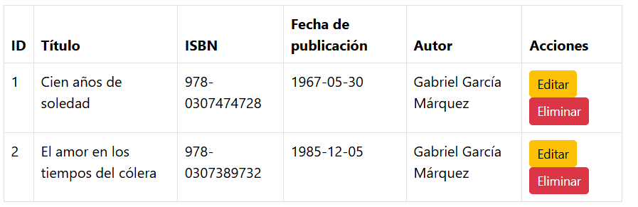
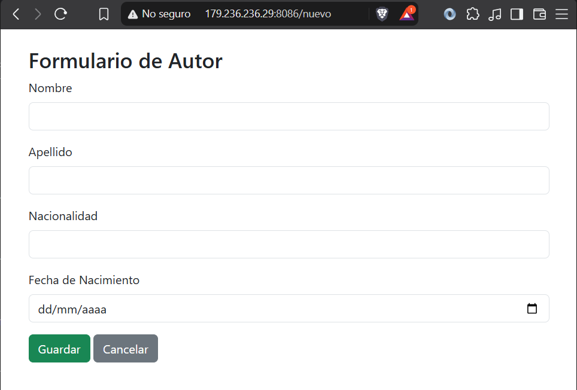
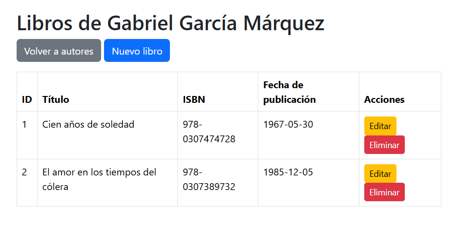
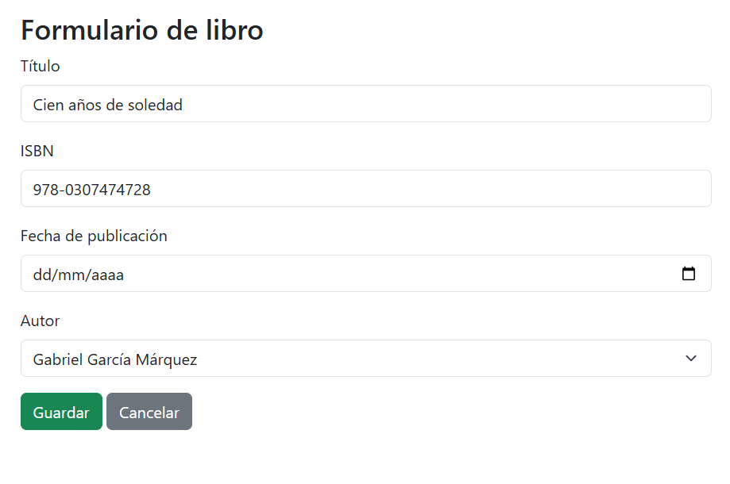
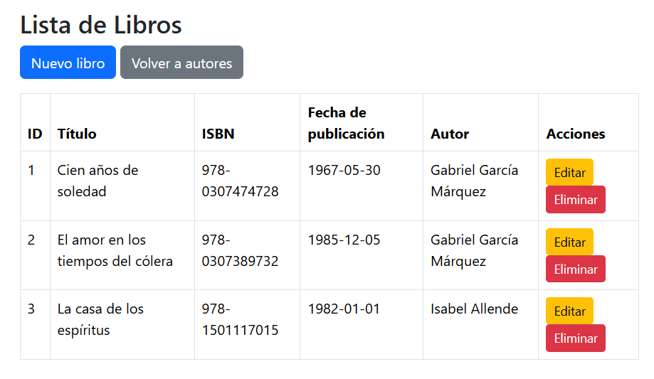
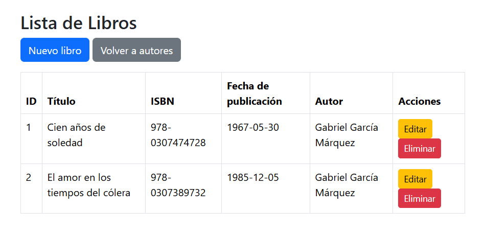

# CRUD de autores y libros

GAEL MARTINEZ CRUZ 23161006

Aplicación web desarrollada con Spring Boot, Spring Data JPA, Thymeleaf y MySQL para administrar autores y sus libros. El proyecto está desplegado en una VPS de hostinger

## Entidades y relación

- **Autor (`Autores`)**: identificador, nombre, apellido, nacionalidad y fecha de nacimiento.
- **Libro (`Libros`)**: identificador, título, ISBN y fecha de publicación.
- **Relación**: un autor puede tener varios libros (`@OneToMany`) y cada libro pertenece a un autor (`@ManyToOne`). La clave foránea `id_autor` es obligatoria en un libro.

## Uso en la VPS

(http://179.236.236.29:8086) 

| Función | Ruta |
|---|---|
| Listar autores | http://179.236.236.29:8086 |
| Crear autor | http://179.236.236.29:8086/nuevo |
| Administrar libros | http://179.236.236.29:8086/libros |
| Crear libro | http://179.236.236.29:8086/libros/nuevo |
| Ver los libros de un autor | http://179.236.236.29:8086/ver-libros/1 |

## Capturas

1. **`01-relacion-entidades.png` — Entidades relacionadas:** 

2. **`02-crear-autor.png` — Crear:** 

3. **`03-consultar-libros-y-autor.png` — Leer y relación:** 

4. **`04-actualizar-libro.png` — Actualizar:** 

5. **`05-eliminar-libro.png` — Eliminar:** 

